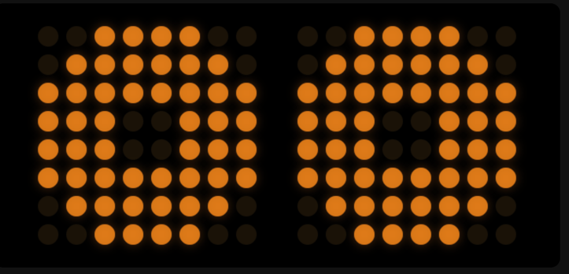
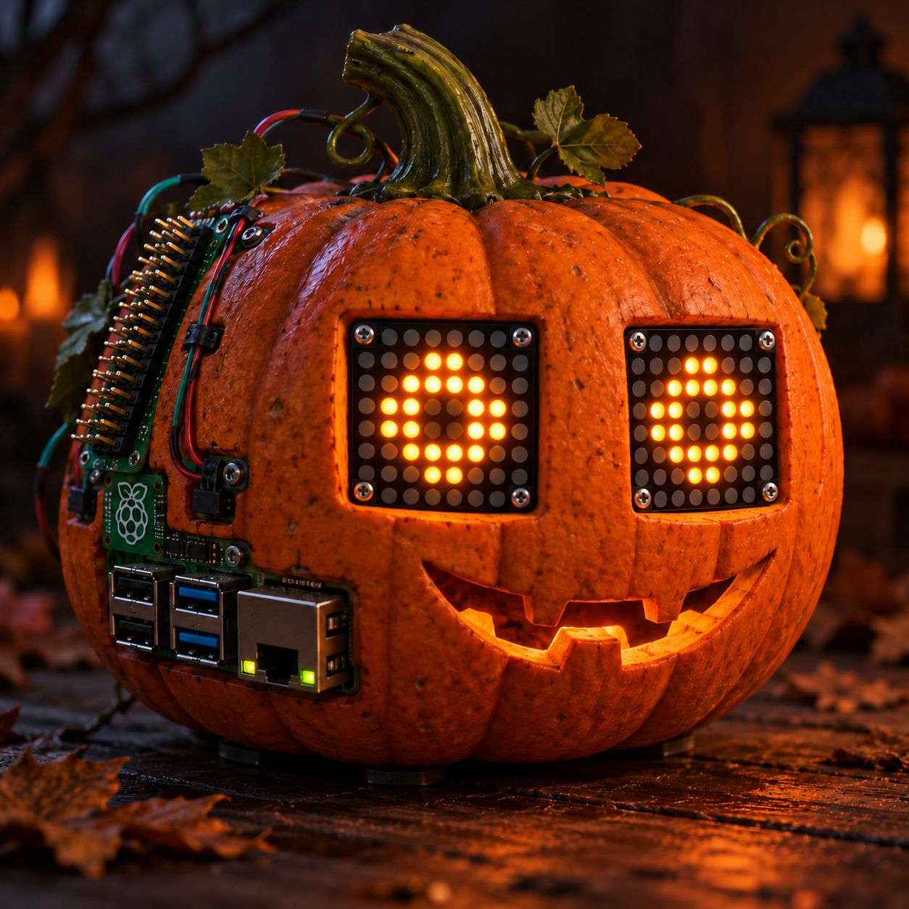
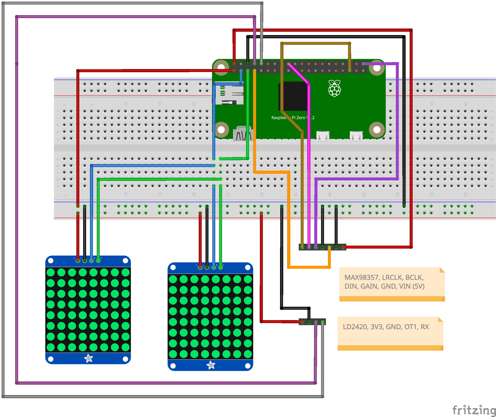

= Scare Pi

Happy Halloween!

This is a spooky Halloween Raspberry that has turned itself (well, maybe by the help of other orange tools) into a Halloween thing, looking at you, moaning, and once you come closer, it awakens.

====
Obviously, this is a https://www.google.com/search?q=pumpkin+pie[pumpkin pie]

====

It is essentially a https://www.raspberrypi.com/products/raspberry-pi-zero-2-w/[Raspberry Pi Zero 2 W] with two https://www.adafruit.com/product/1855[8x8 LED Matrix (I2C)] as eyes, a https://www.adafruit.com/product/3006[MAX98357A Audio Breakout] for scary sounds and https://www.hlktech.net/index.php?id=1291[LD2420 mmWave sensor] for presence checking.

== Hardware

**Wiring**

The wiring shows the direct pin connections. For real pumpkin usage, using a T-Cobbler or a perma-proto-board gives you the necessary stability.

=== LED matrices (2 × Adafruit 8x8 LED backpack, HT16K33, I2C)

[%header,cols="m,m,>m"]
|===
| Backpack | T-Cobbler | Pi pin
| VCC (both) | 3V3 | 1
| GND (both) | GND | 6
| SDA (both) | SDA, GPIO2 | 3
| SCL (both) | SCL, GPIO3 | 5
|===

One backpack has the A0 jumper bridged, which makes it `0x71`. The other stays at `0x70`.
Left eye `0x70`, right eye `0x71` (`[eyes] addresses` in `scare.toml`).

=== Presence radar (HLK-LD2420, UART)

[%header,cols="m,m,>m"]
|===
| LD2420 | T-Cobbler | Pi pin
| VCC | 3V3 | 17
| GND | GND | 9
| OT1 | RXD, GPIO15 | 10
| RX | TXD, GPIO14 | 8
|===

Firmware 1.5.3 and newer use TX on OT1 at 115200 baud.
Older sensors (1.5.2 and below) use TX on OT2 at 256000 baud: wire `OT2` to `RXD` instead and set
`[radar] baud = 256000`. `python3 ld2420.py --new` prints the firmware version.
The Pi's UART must be free: no serial console, `enable_uart=1` (see <<software>>).

=== Amplifier (Adafruit MAX98357A I2S, mono)

[%header,cols="m,m,>m"]
|===
| MAX98357A | T-Cobbler | Pi pin
| Vin | 5.0V | 2
| GND | GND | 39
| BCLK | #18 (GPIO18) | 12
| LRC | #19 (GPIO19) | 35
| DIN | #21 (GPIO21) | 40
| SD | #4 (GPIO4) | 7
| GAIN | GND | 39
|===

GAIN tied to GND fixes the gain at 12 dB (when left floating, the level drifts).
SD on GPIO4 lets the driver switch the amplifier on with the stream (`dtoverlay=max98357a,sdmode-pin=4` in `/boot/firmware/config.txt`).
The one audio stream in `scare.py` never closes, so the amplifier never clicks.
Speaker on the screw terminal, 4 or 8 Ω.

=== Mouth (SK6812 RGBW strip, SPI, optional)

[%header,cols="m,m,>m"]
|===
| SK6812 | T-Cobbler | Pi pin
| 5V | 5.0V | 4
| GND | GND | 34
| DIN | MOSI (GPIO10) | 19
|===

Ten pixels are enough, cut the strip after them (the rest would idle at about 1 mA each).
The Pi drives DIN with 3.3 V against a 3.4 V threshold, which works on a short lead, otherwise put a 74AHCT125 in between.
White on ten pixels draws up to 0.8 A, so give the Pi a 2.5 A supply.
Set `enabled = true` in `[mouth]` of `scare.toml`. `pin` is the data GPIO, 10 is the only free SPI MOSI (20 clashes with I2S).

[[software]]
== Software

Plain Python 3.11+ on Raspberry Pi OS, no virtualenv, no build step.
The whole show is one process: `scare.py` reads the radar, drives the eyes and
feeds one never-closing audio stream (to avoid amplifier clicks, SD mode already helps with these but on my system, they never went fully away).

=== Pi setup

Packages:

[source,bash]
----
sudo apt install alsa-utils python3-serial python3-smbus2 python3-spidev ffmpeg
----

`/boot/firmware/config.txt`:

[source,ini]
----
dtparam=i2c_arm=on
enable_uart=1
dtoverlay=max98357a,sdmode-pin=4
dtparam=spi=on       # mouth only
core_freq=250        # mouth only: SK6812 bit timing comes from the SPI clock
----

Disable the serial console (`sudo raspi-config` -> `Interface Options` -> `Serial Port`:
login shell *no*, hardware *yes*), then reboot. `/dev/serial0` is the radar.

Volume: the MAX98357A has no volume control, so `~/.asoundrc` adds an ALSA
softvol and makes it the default device:

[source]
----
pcm.softvol {
    type softvol
    slave.pcm "plughw:1,0"
    control { name "Volume"; card 1 }
    max_dB 0.0
}
pcm.!default {
    type plug
    slave.pcm "softvol"
}
ctl.!default {
    type hw
    card 1
}
----

After the first playback the control exists: `amixer -c 1 sset Volume 50%`.

=== Sounds

Drop wav files into `sounds/`: 44.1 kHz, stereo, 16 bit. Every sound moment
(arrival, jumpscare, leaving, ambience while asleep) picks one at random.
Convert anything else with ffmpeg:

[source,bash]
----
ffmpeg -i moan.ogg -ac 2 -ar 44100 -c:a pcm_s16le sounds/moan.wav
----

Easter egg: `[easter_egg]` in `scare.toml` names a sound outside the pool and a
chance. Now and then, while nobody is around, the eyes and mouth turn into the
KITT scanner with that sound.

=== Run

Check `scare.toml` (distances, cooldown, I2C addresses, matrix rotation), then:

[source,bash]
----
python3 scare.py                # the show. Ctrl+C for exit and turns the eyes off
python3 scare.py --simulated-presence-distance 1.5   # no radar: a visitor at 1.5 m
----

Autostart on boot:

[source,bash]
----
sudo cp scary.service /etc/systemd/system/
sudo systemctl enable --now scary
journalctl -fu scary
----

=== Try each part individually

[source,bash]
----
python3 eyes.py                 # eye story loop on the matrices
python3 eyes.py --all --cap 2   # every scene, 2 s each
python3 eyes.py explode crazy   # named scenes
python3 mouth.py --all --cap 2  # the same scenes on the strip
python3 ld2420.py --new         # radar handshake, firmware, 1 Hz presence log
python3 audio_test.py sounds/T01.wav   # beep, sound, beep in one stream
python3 matrix_test.py          # blink both matrices
----

=== Develop

[source,bash]
----
make test                       # eye model and director tests, no hardware needed
----

== License

This project is Open Source software released under the https://www.apache.org/licenses/LICENSE-2.0.html[Apache 2.0 license].